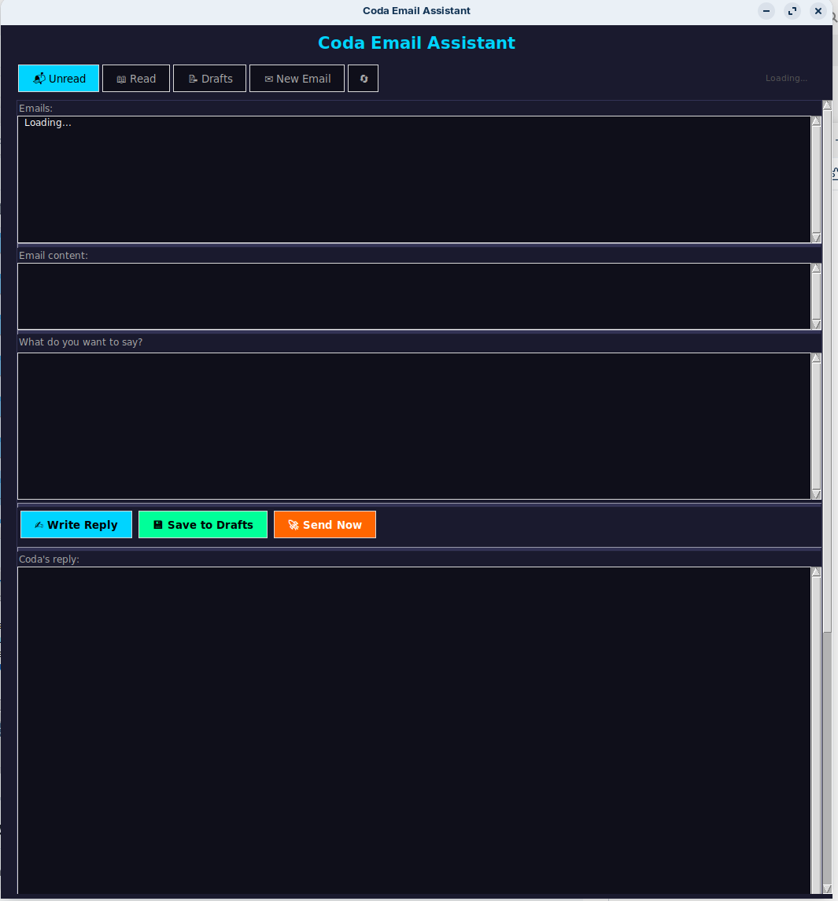
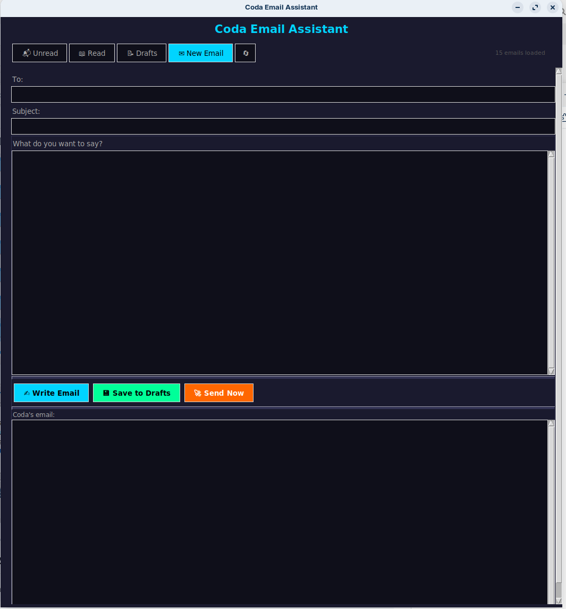

# Coda 🤖

> **Your local AI assistant. Right-click any folder to code. Write emails in plain language. No subscription. No cloud. No limits.**

I was fed up with AI subscriptions and hitting limits constantly. So I built my own offline AI assistant that lives on my machine, knows my files, writes my emails, and costs nothing to run.

This is Coda — a coding assistant and email agent that sits quietly in your system tray (Linux) or menu bar (macOS) until you need it.

---

## Features at a Glance

| Feature | Description |
|---|---|
| **System tray** | C icon lives in your taskbar (Linux) or menu bar (macOS), always one click away |
| **Right-click → Call Coda** | Opens a coding session in any folder from the file manager |
| **Launch Coda** | Folder picker from the tray to start a coding session anywhere |
| **Startup splash** | Pixel-art "CODA" fades in and out when Coda starts |
| **Terminal fill level** | C icon fills green → yellow → red as coding sessions open (up to 10) |
| **Email Agent** | Reads inbox, writes replies, saves to Drafts or sends — all from one window |
| **Model switcher** | Switch the coding AI provider instantly from the tray |
| **Clean install & uninstall** | One command installs, `coda update` updates, `coda uninstall` removes every trace |
| **Preferences window** | Configure everything from a clean UI — no config files to edit |
| **Single-instance windows** | Email Agent and Preferences hide when you close them, reopen instantly from tray |
| **Privacy first** | The Email Agent uses a local model by default — your emails never leave your machine or your own Ollama server. Claude, Gemini or OpenAI are opt-in, with a clear warning |
| **Aider-powered coding** | Git commit on every change, `/undo`, `/diff`, full file editing |

---

## Screenshots





---

## Coding Assistant

**Call Coda opens the coding agent you already use** — pick one in Preferences or from the tray (*Coding Agent*):

| Agent | Notes |
|---|---|
| [Claude Code](https://claude.com/claude-code) | uses its own login |
| [Codex CLI](https://github.com/openai/codex) | uses its own login |
| [Cursor Agent](https://cursor.com/cli) | uses its own login |
| [Gemini CLI](https://github.com/google-gemini/gemini-cli) | uses its own login |
| [Aider](https://aider.chat) | works with local Ollama models or a Gemini / Claude / OpenAI key — the 100 % offline option |

Start a coding session in three ways:

- **C → Launch Coda** in the tray → pick a folder from the dialog
- **Right-click any folder → Call Coda** in your file manager *(Linux only — see note below)*
- From the terminal:

```bash
cd ~/my-project
coda
```

A terminal opens in that folder with your agent ready to work on your files. With Aider, for example:

```
> create a weather app with vanilla HTML CSS and JS
> fix the temperature conversion bug in app.js
> add a dark mode toggle to index.html
> explain what this function does
```

Every change Coda makes is automatically committed to git with a description.
Type `/undo` to roll back the last change instantly.

> **macOS note:** The right-click "Call Coda" option in Finder is not available on macOS.
> macOS does not allow third-party apps to add custom right-click actions to Finder without a
> signed App Extension. Use **C → Launch Coda** from the menu bar or the `coda` terminal command instead.

### Useful Aider commands inside a session (when Aider is your agent)

```
/add .          add all project files to the session
/add index.html add a specific file
/undo           roll back the last change
/diff           see exactly what changed
/ask            ask a question without editing any files
/git            show git log of Coda's commits
/exit           quit
```

---

## Email Agent

**C → Email Agent** in your system tray opens the email window.

- **Tabs** — Inbox, Sent, Drafts, New Email and Contacts
- **Select any email** — Coda reads the whole thread for context
- **Describe your reply in plain language** — *"tell him Tuesday works, ask about the budget"*
- **Coda writes the full email in your voice**
- **Save to Drafts** — appears in your mail app ready to review and send
- **Send Now** — sends directly without leaving Coda
- **Contacts** — private notes per person (*"my sister — warm, informal"*) that shape the tone without ever being quoted
- **Works with Gmail, Outlook, Yahoo and any IMAP/SMTP provider** — Sent and Drafts folders are detected automatically
- **Auto-refresh** — inbox updates automatically every few minutes

Closing the email window with X does **not** quit it — click **C → Email Agent** and it reappears instantly.

**Privacy:** by default the Email Agent writes with a small local model (`coda2.0:3b`, based on Qwen 2.5 3B) through Ollama — on this computer or on your own server — so no email content leaves your machines. Coda connects straight to your mail provider over IMAP/SMTP with an app password.

**Want stronger writing?** In **Preferences → Email → Writes with** you can choose **Claude**, **Gemini** or **OpenAI** with your own API key. Coda warns you first, because the email thread you reply to, your instructions and your contact notes are then sent to that company. Your mail password never is. While a cloud model is active, the Email Agent's title bar says so.

**Don't need email?** Untick **Use the Email Agent** in **Preferences → Email**. The Email Agent then disappears from the tray menu, and the menu only shows Launch Coda and the coding agent settings.


---

## Model Switcher

**C → Switch Model** in the tray lets you change your AI provider instantly — no need to open Preferences.

```
C
├── Launch Coda
├── Email Agent
├── ──────────
├── Model: Ollama (local)   ← shows active provider
├── Switch Model ▶
│     ├── 🏠  Ollama (local)   ✓
│     ├── 🔵  Gemini
│     ├── 🟢  OpenAI
│     └── 🟠  Claude
├── ──────────
├── Preferences
└── Quit
```

If you switch to a cloud provider and haven't added an API key yet, Coda reminds you to open Preferences first.

---

## Supported AI Providers (coding)

| Provider | Free tier | Notes |
|---|---|---|
| Ollama (local) | ✓ free forever | Private — runs on your machine or your own server |
| Gemini | ✓ free tier | Key at [aistudio.google.com](https://aistudio.google.com) |
| Claude | paid | Key at [console.anthropic.com](https://console.anthropic.com) |
| OpenAI | paid | Key at [platform.openai.com](https://platform.openai.com) |

---

## Requirements

- **Linux** — Debian/Ubuntu based (tested on Zorin OS and Ubuntu); the right-click menu needs GNOME Files (Nautilus)
- **macOS** — Ventura or later, with [Homebrew](https://brew.sh)
- Python 3.10+ (aider needs 3.10–3.12; the installer finds or installs one)
- [Ollama](https://ollama.com) for local models and for the Email Agent
- For email: an app password from your mail provider

---

## Install

```bash
bash <(curl -fsSL https://raw.githubusercontent.com/sebamuhr/Coda/main/install.sh)
```

The installer asks which AI to use, your email details (optional) and whether to download the email model. It is **safe to run again** — it updates in place, keeps your settings, and removes any old duplicate copies of Coda it finds.

Useful options: `--yes` (no questions, configure later in Preferences), `--reconfigure`, `--skip-aider`, `--no-autostart`. Run with `--help` for the full list.

**From source (developers):**

```bash
git clone https://github.com/sebamuhr/Coda.git
cd Coda && ./install.sh
```

Coda then runs straight from your checkout, so your edits take effect on the next restart.

### Where Coda keeps things

| Path | What |
|---|---|
| `~/.local/share/coda/` | the app, its Python environment and the coding engine (aider) |
| `~/.config/coda/` | your settings and contacts (only readable by you) |
| `~/.local/bin/coda` | the `coda` command |
| `~/.config/autostart/coda.desktop`, `~/.local/share/applications/coda.desktop` | start on login, app menu entry (Linux) |
| `~/Library/LaunchAgents/com.coda.plist`, `~/Applications/Coda.app` | the same on macOS |

Nothing is written to your shell config, and API keys are never placed on a command line.

### Commands

```bash
coda                 # coding session in the current folder
coda open ~/project  # coding session in a new terminal window
coda doctor          # check the install, find leftovers or duplicate copies
coda update          # update to the latest version
coda uninstall       # remove Coda completely
```

### Update

**C → Preferences → General → Update Coda**, or `coda update`.

### Uninstall

**C → Preferences → General → Uninstall Coda**, or `coda uninstall`. This removes the app, settings, contacts, launchers, the `coda` command and the email model. A git checkout of the source is never deleted.

If Coda is broken or half-removed:

```bash
bash <(curl -fsSL https://raw.githubusercontent.com/sebamuhr/Coda/main/uninstall.sh)
```

---

## Use Coda from your AI agent (skill)

Coda also ships as an agent skill (`skill/SKILL.md`; build the zip with `./make-skill.sh`). With it, Claude Code, Codex or Cursor can install Coda for you and handle your email through the `coda mail` command:

```bash
coda mail list --unread              # what's new
coda mail read "<message-id>"        # a message with its whole thread
coda mail draft --reply-to "<message-id>" --body-file reply.txt   # saved as a draft
```

Replies are always saved as drafts unless you explicitly ask your agent to send (`coda mail send … --confirm`). Your app password stays in Coda's settings and is never shown to the agent.

---

## How it all fits together

```
Your desktop
│
├── System tray  (C icon)
│   ├── Launch Coda  ──────────────► folder picker → your coding agent
│   ├── Email Agent  ──────────────► email window (hides on X, stays alive)
│   ├── Coding Agent  ─────────────► Claude Code, Codex, Cursor, Gemini or Aider
│   ├── Preferences  ──────────────► configure everything
│   └── Quit  ─────────────────────► closes everything cleanly
│
├── File manager right-click  (Linux only)
│   └── Call Coda  ────────────────► coding terminal in that folder
│
└── Terminal
    └── coda  ─────────────────────► coding session in current folder
```

---

## Tips

- The **Call Coda** right-click option (Linux only) only appears when Coda is running — quit from the tray and it disappears automatically
- The **fill level** on the C icon shows how many coding sessions are open — green for few, yellow for several, red when busy (max 10)
- **Save to Drafts** is safer for email — review it in your mail app before sending
- Something odd? Run `coda doctor` — it shows what is installed where and how to fix leftovers
- Use `/add .` in a coding session to let Coda see all your project files
- Keep coding instructions focused — one task at a time works best with local models
- Every coding change is a git commit — you always have a full history to roll back

---

## The Story

I'm a no-code developer. I started with Cursor AI and loved it — but the monthly subscription adds up fast, especially when you hit the limits. I wanted something I owned, something offline, something that didn't send my code to servers I don't control.

Coda is what I built. It's [Aider](https://aider.chat) + [Ollama](https://ollama.ai) + Python glue that integrates the whole thing into your desktop. A coding assistant, an email agent, a model switcher, a preferences window — all in one system tray icon that starts with your computer.

Nothing fancy. Just works.

---

## Contributing

Pull requests welcome! Ideas for improvement:

- Support for other file managers (Dolphin, Thunar)
- Windows support
- More email providers and OAuth support
- Calendar integration
- Multiple Ollama server profiles

---

## License, terms and privacy

The code is MIT-licensed (see [LICENSE](LICENSE)).

Using Coda means you accept the [Terms of Use](TERMS.md). In short: Coda is a tool, you are responsible for how you use it and for what your AI agents and emails do, and it comes with no warranty. Coda collects no data at all; see the [Privacy Policy](PRIVACY.md).

---

*Built with frustration, coffee, and a lot of help from Claude* ☕
